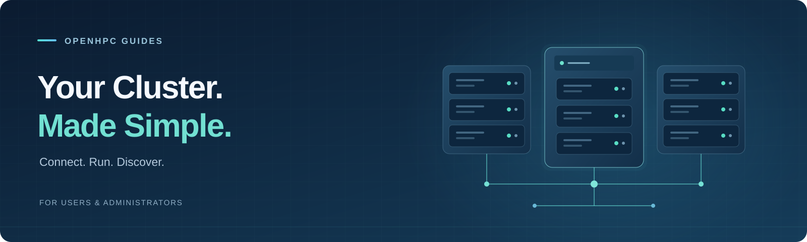

서버 접속부터 계산 실행과 결과 확인까지, 필요한 안내를 선택하세요.

<table>
  <tr>
    <td width="50%" valign="top">
      <h3>👤 사용자 안내</h3>
      
서버 접속 · 파일 전송 · 계산 실행 · 결과 확인

      
<a href="https://leekwangseon.github.io/openhpc-guide/"><strong>사용 시작하기 →</strong></a>

    </td>
    <td width="50%" valign="top">
      <h3>🛠 관리자 안내</h3>
      
계정 · 노드 · 프로그램 · 유지보수

      
<a href="https://leekwangseon.github.io/openhpc-guide/admin.html"><strong>운영 안내 보기 →</strong></a>

    </td>
  </tr>
</table>

<strong>접속</strong> &nbsp; → &nbsp; <strong>파일 준비</strong> &nbsp; → &nbsp; <strong>계산 실행</strong> &nbsp; → &nbsp; <strong>결과 확인</strong>

